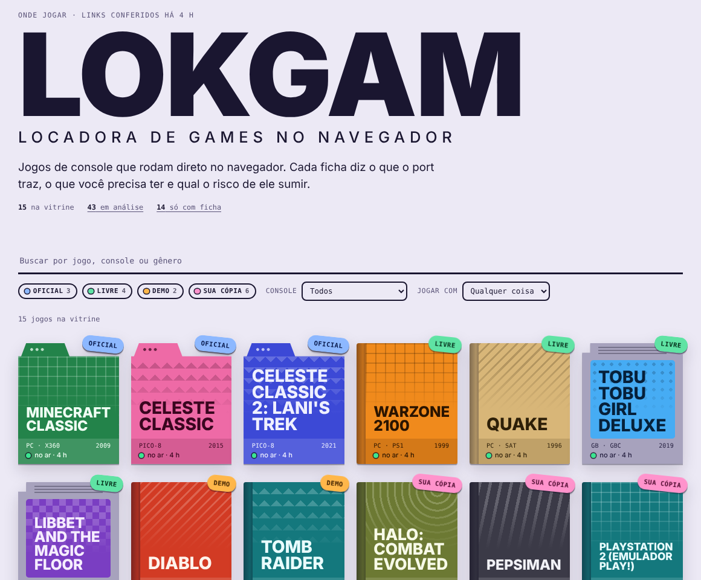
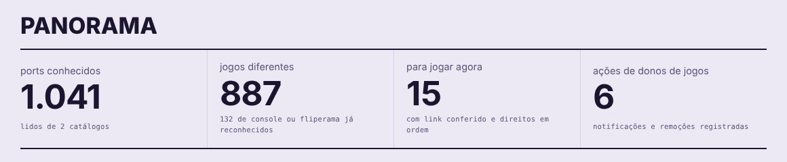

<div align="center">

# 🕹️ LOKGAM

**Observatório dos ports de jogos de console para navegador**

[](https://github.com/GabrielKSG7/LOKGAM/actions/workflows/ci.yml)
[](https://github.com/GabrielKSG7/LOKGAM/actions/workflows/coletar-catalogos.yml)
[](https://github.com/GabrielKSG7/LOKGAM/actions/workflows/conferir-links.yml)


### ▶ [Abrir o observatório](https://gabrielksg7.github.io/LOKGAM/) · [Ver onde jogar](https://gabrielksg7.github.io/LOKGAM/vitrine/)

[](https://gabrielksg7.github.io/LOKGAM/vitrine/)

</div>

Observatório dos ports de jogos de console para navegador. A LOKGAM acompanha a onda de jogos clássicos que passaram a rodar direto no navegador: lê os catálogos que existem, mede se cada port continua no ar, registra notificações de direitos e quedas, e mostra onde dá para jogar de forma legítima.

O projeto nasceu como uma vitrine no espírito do Click Jogos e do FRIV, e a vitrine continua. Cada jogo com link tem uma ficha que diz o que o port distribui, o que o jogador precisa ter e qual o risco de ele sumir, e um robô confere algumas vezes por dia se o link continua no ar.

[](https://gabrielksg7.github.io/LOKGAM/)

> *TL;DR (EN): a data observatory for console games ported to the browser. Two scheduled GitHub Actions robots
> collect third-party catalogs into an append-only bronze layer and check every port's link several times a day;
> a silver layer unifies ports and games; curated JSON tables are validated against JSON Schema and editorial
> rules; metrics and a static site are rebuilt on every run. No server, no database — Git is the storage.*

### Destaques técnicos

- **Git como banco de dados:** tabelas em JSON/JSONL versionadas, com histórico completo de cada mudança, e o site gerado de novo a cada execução. Nenhum servidor, nenhum custo.
- **Bronze/prata sobre arquivos:** os catálogos de terceiros entram como retratos e mudanças *append-only*; a camada prata unifica ports e jogos.
- **Dois robôs agendados** no GitHub Actions: a coleta de catálogos (diária) e a conferência de links (algumas vezes por dia), que gravam e publicam sozinhos.
- **Regras de curadoria executáveis:** `validate.py` recusa a base inteira se uma ficha violar o JSON Schema ou uma regra editorial (por exemplo, port que embute jogo comercial nunca vai para a vitrine com link).
- **Disponibilidade medida com honestidade:** site que barra o robô é "não conferido", não "fora do ar", e não entra na conta.
- **134 testes** e um CI que falha se o site publicado não bater com o que a base gera.

O projeto é um protótipo em evolução.

## Como funciona

```
catálogos na web ──► collect_catalogs.py ──► data/bronze/ ──┬──► silver.py ──► data/silver/ ──┐
                     check_catalog.py                          │                                 │
                     (robôs, uma vez por dia)                  └──► dbt (gold.py) ──► data/gold/ ─┤
                                                                                                 ▼
data/*.json(l) ──────────────────────────────────────────────────► validate.py ──► metrics.py ──► build.py ──► docs/
      ▲
      │
check_links.py (robô, algumas vezes por dia)
```

A base são arquivos de texto versionados no Git. Os robôs acrescentam linhas, as métricas são recalculadas e o site é gerado de novo, tudo no GitHub Actions. Não há servidor nem banco de dados.

```
data/ports.json         fichas dos ports (uma por port, não por jogo)
data/events.json        fatos datados: lançamentos, notificações, remoções, quedas
data/checks.jsonl       conferências de link, uma linha por conferência
data/catalogs.json      outros catálogos, listas e portais de ports
data/sources.json       fontes de coleta: qual catálogo, por onde é lido, com qual leitor
data/bronze/            retratos dos catálogos, mudanças e registro das coletas
data/silver/            ports e jogos unificados, derivados da bronze e das fichas
data/gold/              tabelas finais da camada ouro, exportadas do dbt
dbt/                    projeto dbt (DuckDB): staging, intermediate e marts, com testes de dados
data/reference/         tabela de jogos de console e fliperama, mantida à mão
schema/                 JSON Schema de cada tabela
scripts/validate.py     valida formato e regras de curadoria
scripts/format_base.py  regrava ports.json no formato canônico
scripts/check_links.py  o robô de conferência
scripts/collect_catalogs.py  o robô de coleta de catálogos
scripts/check_catalog.py     o robô que confere as versões jogáveis dos catálogos
scripts/silver.py       monta a camada prata
scripts/gold.py         roda o dbt e exporta a camada ouro
scripts/metrics.py      métricas do observatório
scripts/build.py        gera docs/ a partir da base e de web/
web/                    modelos das páginas, CSS e JS compartilhados
tests/                  testes (pytest)
docs/                   site gerado; não edite à mão
```

## Modelo de dados

Três tabelas curadas, ligadas por `ports.id`, e uma de apoio. As tabelas do pipeline (bronze e prata) estão descritas em "O pipeline de catálogos".

| Tabela | Grão | Muda como | Para que serve |
|---|---|---|---|
| `ports` | um port (jogo + quem publicou + endereço) | editada pela curadoria | a ficha que aparece na vitrine |
| `events` | um fato datado sobre um port | só cresce | histórico de quedas e linha do tempo da ficha |
| `checks` | uma conferência de link | só cresce | a luz de status na capa e a disponibilidade no observatório |
| `catalogs` | outro catálogo, lista, ferramenta ou portal | editada pela curadoria | a seção "Outros catálogos" da vitrine |

Os campos que sustentam a curadoria ficam em `ports`:

| Campo | Valores | O que significa |
|---|---|---|
| `rights.status` | `official`, `free`, `demo`, `byo_files`, `bundled`, `unknown` | o que o port distribui e com que direito |
| `port.technique` | `native_web`, `source_port`, `reimplementation`, `decompilation`, `recompilation`, `emulation`, `unknown` | como o jogo chegou ao navegador |
| `curation.state` | `approved`, `pending`, `rejected` | se a ficha aparece na vitrine |
| `curation.risk` | `low`, `medium`, `high` | avaliação editorial do risco de remoção |
| `requirements.user_files` | lista | arquivos que o jogador precisa fornecer, e para quê |
| `label` | forma, cor e estampa | a capa gerada pela página, já que arte oficial não é usada |
| `own_copy_route` | id de outra ficha | o caminho para quem tem o jogo, mostrado nas fichas sem link (por exemplo, o emulador do console) |

A descrição de cada campo está nos arquivos de `schema/`.

## Regras de curadoria

O `validate.py` recusa a base se alguma destas regras falhar:

- Ficha aprovada tem link para jogar, selo listável (`official`, `free`, `demo` ou `byo_files`), técnica conhecida, risco avaliado, capa e pelo menos uma conferência de link.
- Selo `byo_files` exige um arquivo marcado como necessário para jogar. Selo `demo` exige um arquivo que libere o jogo completo.
- Port que embute o jogo de terceiros (`bundled`) só existe como ficha rejeitada.
- Ficha rejeitada não guarda link para jogar, mas tem capa: aparece na prateleira "Só a ficha", sem botão de jogar, e seus eventos alimentam o histórico de quedas.
- `own_copy_route` só pode apontar para uma ficha `byo_files` que não esteja rejeitada.
- Ficha aprovada ou rejeitada precisa de fonte. Ficha em análise pode entrar sem fonte, como indicação a conferir.
- Catálogo só guarda endereço quando há fonte dizendo que ele não hospeda jogos. Os que hospedam, e os ainda não conferidos, aparecem só pelo nome.

O risco é uma avaliação editorial, não um parecer jurídico.

### Jogos comerciais (Budokai, PES e afins)

Entram na base, com duas condições:

- **Com link** só quando o port pede os arquivos da cópia do jogador (selo "Sua cópia").
- **Sem link** quando o port já vem com o jogo dentro. A ficha vai para a prateleira "Só a ficha": conta de onde vêm os dados, como o port roda e o que já aconteceu com ele, e alimenta o histórico de quedas e o observatório.
- **Console inteiro:** um emulador que roda no navegador e abre o disco do próprio jogador entra como ficha "Sua cópia". As fichas sem link de jogos daquele console apontam para ele.

Quase todos os ports de PS2 noticiados em 2026 embutem o jogo, então a maior parte dessa geração está em "Só a ficha" ou em análise.

## O robô de conferência

O `check_links.py` abre a página de cada port que tem link guardado (fichas aprovadas e em análise), lê só o começo da resposta e grava uma linha por port em `checks.jsonl`. Ele se identifica como `LOKGAM-conferencia`, com o endereço deste repositório, e não tenta se passar por navegador.

Cada conferência tem um **estado**, que é o que a luz da capa mostra, e um **motivo**, que é o que a análise usa:

| A resposta | Estado | Motivo |
|---|---|---|
| 2xx | `online` | `ok` |
| 401, 403, 429 ou desafio contra robôs | `unverified` | `bot_blocked` |
| 404 ou 410 | `offline` | `not_found` |
| 451 | `offline` | `legal_block` |
| Endereço que não resolve | `offline` | `dns_error` |
| 5xx | `unstable` | `server_error` |
| Sem resposta a tempo, conexão recusada, certificado inválido | `unstable` | `timeout`, `connection_error`, `tls_error` |
| 2xx em página curta que diz que o jogo foi removido | `unstable` | `takedown_notice` |

Decisões que valem saber:

- **Site que barra o robô não é site fora do ar.** A conferência fica como "não conferido" e não entra na conta de disponibilidade.
- **Falha passageira ganha mais duas tentativas.** Bloqueio, 404 e aviso de remoção não: insistir não muda a resposta.
- **Aviso de remoção pede conferência à mão.** O robô marca como instável e avisa na ficha, em vez de declarar o port morto sozinho.
- **Robô sem rede não grava nada.** Se todas as conferências de uma passagem falharem por erro de rede, o script sai com erro e a base fica como estava.

Na página, vale a última conferência que de fato viu o site, e ela vale por 72 horas. Depois disso a capa volta para "não conferido": a vitrine nunca afirma o estado de agora com base em dado velho.

## O observatório

O `metrics.py` calcula, a partir das três tabelas:

- **Disponibilidade por port:** conferências com resposta normal, divididas pelas conferências em que o robô viu o site. A porcentagem só aparece depois de 8 conferências válidas.
- **Notificações e quedas por mês:** eventos com fonte, separados em ação de dono de jogo (notificação ou remoção) e queda.
- **Quem agiu:** donos de jogos que notificaram ou removeram ports.
- **Raio-x da base:** fichas por técnica de port e por estado de curadoria.

Um limite de propósito: a LOKGAM não guarda link de port que embute o jogo, então esses ports não são conferidos pelo robô. O que se sabe deles vem de notícias e entra como evento.

## O pipeline de catálogos

Os catálogos de ports que existem na web são tratados como fonte de dados. O desenho segue o modelo de camadas (bronze, prata, ouro), e as três estão prontas.

### Bronze: o retrato de cada catálogo

Uma vez por dia, `collect_catalogs.py` lê cada fonte ativa de `data/sources.json` e grava em `data/bronze/`:

| Arquivo | O que guarda |
|---|---|
| `<fonte>/snapshot.jsonl` | o retrato mais recente da lista, uma entrada por linha, em ordem de chave |
| `<fonte>/changes.jsonl` | o que entrou, saiu ou mudou entre um retrato e o seguinte; só cresce |
| `runs.jsonl` | uma linha por fonte a cada execução: resultado, hash do original e medidas de qualidade da leitura |

Decisões de projeto:

- **Identidade sem endereço.** De cada entrada ficam o título, o domínio da versão jogável e o dono do repositório do código. O endereço completo e o texto original não são gravados. Do endereço fica uma impressão digital (hash), que basta para saber se ele mudou.
- **Idempotência.** Se o hash do original é o mesmo da última coleta, nada é lido de novo e a execução fica registrada como `unchanged`.
- **Retrato inicial.** A primeira coleta de uma fonte não gera mudanças, e trocar a versão do leitor gera um retrato novo. Assim `changes.jsonl` só tem mudança do catálogo, nunca mudança da leitura.
- **Proteções.** Espelho quando a origem falha, `robots.txt` obedecido nas fontes que são páginas, recusa da coleta que traz menos da metade do retrato anterior, e descarte (contado) de entrada fora do schema.
- **Qualidade medida.** Cada execução registra quantas tabelas e linhas leu, quantas linhas vieram sem link e quantas chaves se repetiram. No Ultimate Catalog, o total lido é comparado com o que a própria lista declara, e a estrela que a lista dá a quem tem versão jogável e código serve para conferir a leitura dos links.

| Fonte | Situação |
|---|---|
| Ultimate Catalog of Web Game Ports | coletada, pelo README da lista, com espelho |
| BottleShip (lista de compatibilidade) | coletada |
| Ported2Browser | não coletada: o site pede que robôs não o leiam |

Uma entrada de catálogo ainda não é uma ficha. A mesma versão aparece em mais de uma lista, muita coisa ali é jogo de PC e não port de console, e nada foi classificado quanto a direitos.

### Estão no ar? A conferência diária

Depois da coleta, `check_catalog.py` abre cada versão jogável listada e grava a situação dela (no ar, instável, fora do ar ou não conferida), pela chave da entrada. Os endereços vêm do catálogo na hora e só existem na memória. `status.jsonl` guarda a situação atual e desde quando; `status_changes.jsonl` guarda cada troca e só cresce, o que basta para reconstruir a história sem gravar uma linha por port por dia. A primeira conferência de uma entrada é o ponto de partida e não conta como troca. Cada domínio recebe um pedido por vez, com intervalo entre eles.

### Prata: ports e jogos

`silver.py` lê a bronze, as fichas curadas e a tabela de referência, e grava `data/silver/ports.jsonl` e `games.jsonl`. É uma função pura dos arquivos do repositório: a validação refaz a conta e acusa se a prata estiver desatualizada.

- **Um port por versão jogável.** Entradas com o mesmo endereço (pela impressão digital) viram um port só. O id do port é a sua primeira entrada de catálogo, como `fonte:chave`.
- **Ports agrupados por jogo.** O nome do jogo é o título sem o que a lista põe entre parênteses no fim, como `(2)`, `(2005)` ou o nome do port, e com as grafias niveladas: GTA e Grand Theft Auto, II e 2, & e and.
- **Ligação com as fichas.** Cada ficha procura o seu port pelo indício mais forte que houver: mesmo endereço e mesmo jogo; mesmo domínio e mesmo jogo; mesmo endereço, se for o único; mesmo repositório. O campo `ficha_match` diz qual valeu.
- **Origem do jogo.** A plataforma em que o jogo nasceu vem de `data/reference/console_games.json`; sem ela, da primeira plataforma da ficha. O que não está em nenhuma das duas fica sem classificação, em vez de ser chutado.
- **Linha do tempo.** `first_seen` é a data em que a coleta viu o port. Para quem já estava no primeiro retrato ela é só um teto, e `first_seen_basis` diz isso. Saídas e trocas de domínio vêm de `changes.jsonl`.
- **Fora das listas públicas.** Títulos adultos ou sensíveis ganham uma marca e não entram em nenhum ranking do site.

Limites conhecidos: o agrupamento por nome erra quando duas listas chamam o mesmo jogo de formas muito diferentes, e a tabela de referência cobre só uma parte dos jogos.

### Ouro: os achados (dbt + DuckDB)

`gold.py` roda `dbt build` sobre a pasta `dbt/` e exporta as tabelas finais para `data/gold/`. O DuckDB lê os arquivos da bronze direto do disco; o banco é descartável e não vai para o Git.

| Camada dbt | Modelos | O que faz |
|---|---|---|
| staging | `stg_*` | lê cada arquivo JSON Lines da bronze com colunas e tipos declarados |
| intermediate | `int_entries`, `int_state_intervals` | descobre quando cada versão foi conferida pela primeira vez e refaz a história dela em intervalos de situação |
| marts | `gold_outages` | cada período fora do ar, com começo, fim, motivo do fim e se foi coletivo |
| | `gold_collective_outages` | quedas coletivas: um domínio derrubando várias versões na mesma conferência |
| | `gold_daily_status` | situação de todas as versões em cada conferência, refeita a partir das trocas |
| | `gold_catalog_daily` | entradas e mudanças do catálogo por coleta |
| | `gold_findings` | números de cabeçalho, mostrados na seção "Achados" da página inicial |
| | `gold_evolution_daily` | a base dia a dia: ports listados, entradas e saídas, versões fora do ar |
| | `gold_platform_summary` | ports listados agora por plataforma de origem do jogo, com a situação |
| | `gold_new_ports`, `gold_broken_ports` | o que chegou depois do retrato inicial e o que está fora do ar agora |

Decisões de projeto:

- **Guardar trocas, não fotos diárias.** A bronze grava só quando uma versão muda de situação. A camada ouro refaz o estado de cada dia a partir disso.
- **A reconstrução é testada contra a fonte.** O teste `daily_status_matches_robot_counts` confere, a cada execução, se a situação refeita bate com o que o robô contou em cada conferência. Se a lógica de intervalos ou a gravação das trocas tiver defeito, o build falha.
- **Começo desconhecido é dito.** Versão que já estava fora do ar na primeira conferência tem `started_basis = before_first_check`, e fica fora das medidas de duração.
- **Queda coletiva** é quando três ou mais versões do mesmo domínio caem na mesma conferência (`collective_min_ports` em `dbt_project.yml`). Separa o espelho que caiu do port que caiu.
- **Uma foto por dia sem guardar fotos.** A coleta é diária e só grava o que mudou; `gold_evolution_daily` refaz a lista de cada dia a partir da prata (quando cada port apareceu e saiu). Os testes `evolution_matches_silver` e `broken_ports_match_robot` conferem as contas contra a prata e contra a última conferência.
- **Fim da história.** Quando uma versão sai do catálogo, a conferência grava uma troca para `unlisted`, e a queda em andamento termina com o motivo `removed`.

Os testes em `tests/test_gold.py` rodam o dbt sobre uma história de exemplo escrita à mão e comparam o resultado com a resposta esperada.

Limites: a precisão é de um dia, porque a conferência é diária; e o período observado ainda é curto. As medidas de sobrevivência (quanto tempo um port dura desde que aparece) precisam de mais semanas de coleta.

## As páginas

| Endereço | O que é |
|---|---|
| `/` | o observatório: panorama, últimos acontecimentos, onde jogar, catálogos, disponibilidade e histórico de quedas |
| `/evolucao/` | a evolução: novos ports por coleta, ports por console, o que chegou e o que está quebrado agora |
| `/vitrine/` | a vitrine: capas dos jogos com link, fichas sem link, fila de análise e outros catálogos |
| `/observatorio/` | endereço antigo do observatório; redireciona para a página inicial |

A vitrine era a página inicial até 11/11/2026. Links antigos para fichas (`/#ficha-...`) são levados para `/vitrine/`.

## Limites conhecidos

- **O agendamento atrasa.** O GitHub não garante o horário dos workflows agendados; já houve conferência saindo mais de duas horas depois do previsto. Por isso uma conferência vale por três dias na vitrine.
- **Alguns sites barram o robô.** Quando o site responde com bloqueio de robôs, o port fica como "não conferido" e não como "fora do ar". Nesses casos só uma conferência manual atualiza a luz.
- **Uma fonte grande só.** Quase tudo da coleta vem de um catálogo. As métricas de catálogo descrevem essa lista, não a web inteira.
- **Classificação parcial.** A origem (console, fliperama ou PC) é conhecida para uma parte pequena dos jogos coletados. O resto aparece como não classificado.
- **Agrupamento por nome.** Ports do mesmo jogo com nomes muito diferentes ficam separados, e não há ainda uma tabela de ligações manuais.
- **Histórico curto.** As datas de entrada dos ports só passam a ser exatas para o que surgir depois do primeiro retrato, de 11/11/2026.
- **Sem testes das páginas no navegador.** Os testes cobrem os dados que as páginas recebem; o comportamento em tela é conferido à mão.

## Como rodar

```
pip install -r requirements-dev.txt
python3 scripts/validate.py                 # valida a base
python3 scripts/format_base.py              # põe ports.json no formato canônico
python3 scripts/collect_catalogs.py --dry-run   # coleta os catálogos sem gravar nada
python3 scripts/silver.py                   # refaz a camada prata (o build.py já faz isso)
python3 scripts/gold.py                     # roda o dbt (modelos e testes) e exporta data/gold
pytest                                      # roda os testes
python3 scripts/check_links.py --dry-run    # confere os links sem gravar
python3 scripts/build.py                    # gera docs/
```

Os testes do robô sobem um servidor HTTP local e exercitam cada tipo de resposta, sem depender da internet.

## Automação

| Workflow | Quando roda | O que faz |
|---|---|---|
| `conferir-links.yml` | agendado a cada 6 horas (na prática, algumas vezes por dia) e sob demanda | confere os links, gera o site e grava tudo em um commit |
| `coletar-catalogos.yml` | uma vez por dia, em horário que varia, e sob demanda | coleta os catálogos, confere as versões jogáveis, roda o dbt, gera o site e grava tudo em um commit |
| `ci.yml` | a cada push e pull request | valida a base, roda os testes e confere se `docs/` está em dia |

Os dois robôs dividem a mesma fila de gravação, para nunca escreverem no repositório ao mesmo tempo. Para rodar um deles na hora: aba **Actions**, workflow **Conferir links** ou **Coletar catálogos**, botão **Run workflow**.

## Como adicionar um port

1. Acrescente a ficha em `data/ports.json`. Se ainda faltar confirmar de onde vêm os dados do jogo, use `curation.state: "pending"` e `rights.status: "unknown"`.
2. Registre uma conferência manual em `data/checks.jsonl`, ou deixe o robô passar.
3. Se houver lançamento, notificação ou queda com fonte, registre em `data/events.json`.
4. Rode `python3 scripts/format_base.py` e `python3 scripts/build.py`, e inclua `docs/` no commit.

## Próximos passos

- Ampliar a tabela de referência e criar uma tabela de ligações manuais, para os casos em que o nome não basta.
- Camada ouro, segunda etapa: sobrevivência dos ports desde que aparecem, quando houver semanas de coleta.
- Mais fontes: catálogos que publiquem um arquivo de dados ou autorizem a leitura.
- Conjunto de dados aberto, atualizado todo dia.
- Esvaziar a fila de análise: abrir cada site e confirmar se pede a cópia do jogador, se é livre ou demo, ou se já traz o jogo.
- Canal para corrigir ou pedir a remoção de uma ficha.
- Domínio próprio.

## Ideias para o futuro

- **Envio pela comunidade:** formulário que cai na fila "Em análise" e só entra depois de aprovado.
- **Launcher próprio:** guardar a biblioteca de arquivos do jogador uma vez só, dizer quais ports aceitam cada arquivo, padronizar controle e tela cheia, jogar offline e abrir só sites curados. Começaria como app instalável a partir do site.
- **Smart TVs:** verificar se a vitrine e os ports rodam nos navegadores de TV (Tizen, webOS, Android TV), que costumam ter suporte limitado a WebAssembly, WebGL 2 e controles. A vitrine precisaria de navegação pelo controle remoto.

## Licença

O código está sob a licença MIT. Os dados seguem a CC BY 4.0, com as ressalvas de [`data/README.md`](data/README.md) para o que é derivado de catálogos de outras pessoas.

## Avisos

A LOKGAM não hospeda jogos: cada ficha leva ao site do próprio projeto. Jogos, nomes e marcas pertencem aos seus donos.
